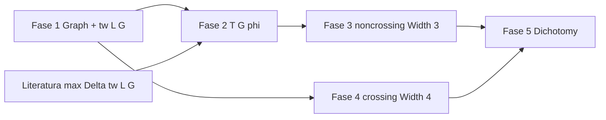

# FASE 0 — Auditoría de solidez: crossing law / pivot Tseitin–width

**Workspace:** local checkout of this repository (path redacted)  
**Fecha:** 2026-08-02  
**Alcance:** lectura de Lean + papers; **sin modificar** archivos `.lean` existentes.  
**Nuevo objetivo (contexto):** demostrar **sin** enumeración finita, catálogos emitidos ni `native_decide` por instancia:

> Para \(G = C_n\) + dos cuerdas (4 extremos distintos, \(\Delta(G)=3\)), y toda marcación impar \(\varphi\):
> - cuerdas **no cruzadas** \(\Rightarrow\) \(\mathrm{Width}(T(G,\varphi)) = 3\)
> - cuerdas **cruzadas** \(\Rightarrow\) \(\mathrm{Width}(T(G,\varphi)) = 4\)

> Estrategia propuesta: \(\mathrm{Width}(T(G,\varphi)) = \max(\Delta(G), \mathrm{tw}(\mathrm{lineGraph}(G)))\) — **caracterización de literatura**, no original del lab.

---

## Resumen ejecutivo (español-friendly)

PNPLab tiene una **capa combinatoria/resolución bien cableada** para el caso cruzado (schedule → esqueleto K₄, proyección G→R, plantilla `k4Closure`), pero **no contiene una demostración universal** del crossing law en el sentido del nuevo objetivo.

| Pregunta | Respuesta |
|----------|-----------|
| ¿`CycleTwoChordsLaw` cuantifica sobre **todo** \(n\)? | **No.** Es un *bundle* de contadores de masa E2 (1421 / 394768 / 461 / …) y metadatos Lean; la cobertura paramétrica explícita es la **ventana finita** \(5 \le n \le 14\). |
| ¿Hay `sorry` / `admit` / `axiom` Lean en módulos crossing? | **`sorry`: 0, `admit`: 0, `axiom` Lean: 0** en todo `lean/PNPLab` (búsqueda global). |
| ¿Qué sustenta hoy el “law”? | Python/GPU (1421, 256784 configs) + **~10 626** usos de `native_decide` en módulos emitidos (461 discharge + catálogos) + estructuras con campos `True := trivial`. |
| ¿Existe `lineGraph` / `treewidth` en Lean? | **No** (solo menciones en `MathlibBridge.lean` como gap upstream). |
| ¿Reutilizable para el pivot gráfico? | Definiciones de grafo (`CrossingEndpoints.toSimpleGraph`), Tseitin XOR, `WidthClosure`, schedule K₄, carga impar bajo fold, ear laws no cruzados — **sí, parcialmente**. Catálogos 461, packs OneFold…TenFold, discharge emit — **no** (deben sustituirse). |

**Veredicto FASE 0:** el estado actual es **evidencia computacional + certificación por instancia**, no una prueba paramétrica \(\forall n\). El pivot a \(\max(\Delta, \mathrm{tw}(\mathrm{L}(G)))\) requiere infraestructura Mathlib (o local) de treewidth / line graph y una reformulación de “Width” alineada con la literatura de complejidad de resolución.

---

## 1. Mapa de definiciones (file:line)

### 1.1 Resolución y “Width”

PNPLab **no define** un operador global `Width(T(G,φ)) : Nat`. En su lugar:

| Concepto | Ubicación | Notas |
|----------|-----------|-------|
| Cláusula, ancho de cláusula | `Resolution.lean:10–13` | `Lit`, `Clause`, `clauseWidth := length` |
| Resolución orientada | `Resolution.lean:26–38` | `resolveOriented`; tautologías → `none` |
| Derivación inductiva | `ResolutionClosure.lean:9–16` | `Derivation axioms C` |
| Ancho de derivación | `ResolutionClosure.lean:18–21` | `derWidth` = max ancho en la derivación |
| **WidthClosure** (cierre abstracto ancho \(w\)) | `ResolutionClosure.lean:51–58` | `mem : Clause → Prop` + axiomas + cierre bajo resolución acotada |
| Proyección G→R | `ResolutionClosure.lean:60–76` | `ProjectionInclusion`, `no_empty_of_projection` |
| Saturación ejecutable | `WidthSaturate.lean:65–67` | `saturate axioms w pivots` (fixpoint fuel 500) |
| Empaquetado desde lista emitida | `ClosureFromList.lean:46–59` | `closureFromEnumerated` / `closureFromSaturated` |
| `axiomWidth` (lab, no resolución clásica) | `TseitinWidth.lean:27–30` | max de anchos en lista; **no** conectado a `derWidth` |

**Gap vs literatura (Ben-Sasson–Wigderson, Atserias, Galesi–Itsykson–Riazanov–Sofronova, de Colnet–Mengel JAIR 2021, Itsykson et al. SAT 2022):**  
La literatura usa *minimum width* \(w\) tal que \(\square \in \mathrm{Closure}_w(T)\) o ancho mínimo de refutación. PNPLab usa `WidthClosure w` como **estructura abstracta** cuya `mem` suele ser **membresía en una lista saturada precomputada**, no el mínimo \(w\). No hay puente formal a \(\max(\Delta, \mathrm{tw}(\mathrm{L}(G)))\).

### 1.2 Tseitin / XOR

| Concepto | Ubicación | Notas |
|----------|-----------|-------|
| Codificación XOR→CNF | `XorCnf.lean:32–42` | `xorCnf`, `xorCnfNorm`; paridad vía `popParity` |
| Axiomas Tseitin paramétricos (cruzado) | `CrossingEndpointsTseitin.lean:39–65` | `oddCharge`, `xorClausesForVertex`, `tseitinAxioms` |
| Variable por arista | `CrossingEndpointsGraph.lean:55–61` | `edgeVar u v` (1-based, orden Python) |
| Grafo \(C_n\) + 2 cuerdas | `CrossingEndpointsGraph.lean:136–149` | `toSimpleGraph` = `cycleGraph n ⊔ edge …` |
| **Closure₃ paramétrico** | `CrossingEndpointsClosure3.lean:23–24` | `closure3 e := saturate (tseitinAxioms e) 3 …` |
| Plantilla K₄ width-3 | `K4Width3.lean:14–34, 82–91` | `k4Axioms`, `k4Closed`, `k4Closure` |

**Alineación Tseitin estándar:**

- ✅ Una variable por arista; restricción XOR paridad en cada vértice (`xorCnfNorm` sobre literales incidentes).
- ⚠️ **Carga impar simplificada:** `oddCharge v = if v = p0 then 1 else 0` (`CrossingEndpointsTseitin.lean:39–41`) — equivalente a “carga unitaria en el extremo mínimo”, **no** una marcación impar arbitraria \(\varphi : V \to \{0,1\}\) con \(\sum \varphi \equiv 1 \pmod 2\) general.
- ⚠️ `OddChargeVec` (`OddChargeFold.lean:145–147`) formaliza imparidad GF(2) en vectores finitos, pero **no está ligado** a `CrossingEndpoints.oddCharge` para \(\varphi\) general.
- ⚠️ Resolución: comentario explícito “Full soundness of resolution remains future work” (`Resolution.lean:4–5`).

### 1.3 Marcación impar / carga

| Concepto | Ubicación |
|----------|-----------|
| `OddChargeVec` + preservación bajo fold | `OddChargeFold.lean:145–166` |
| `unitOddCharge` | `OddChargeFold.lean:177–188` |
| Carga en instancia cruzada | `CrossingEndpointsTseitin.lean:39–41` |
| Preservación bajo fold facial | `OuterplanarFoldStep.lean`, `OddChargeFold.lean` |

### 1.4 Geometría cruzado / no cruzado

| Concepto | Ubicación | Alcance |
|----------|-----------|---------|
| `CrossingEndpoints` (4 extremos ordenados) | `CrossingChordsToArcs.lean:18–26` | **Asume** cruzamiento vía orden \(p_0<p_1<p_2<p_3\) en el ciclo |
| `toArcs` / hop budget | `CrossingChordsToArcs.lean:28–40, 117–121` | \(\forall e\); `total = n-4`; ventana pack si \(5\le n\le 14\) |
| Schedule → K₄ | `CrossingFoldSchedule.lean:84–86`, `K4ResidualCatalog.lean:40–43` | \(\forall\) `CrossingArcs` (conteo combinatorio, no embedding) |
| No cruzado: `NoncrossingTwoChords`, `NoncrossingChordDiagram` | `NoncrossingTwoChordsEar.lean`, `ChordDiagramEar.lean` | Constructivo ear; **no** teorema \(\forall n\) Width=Δ |
| Outerplanar scaffold | `Outerplanar.lean:50–58`, `WhitneyEarAxiom.lean:127–129` | `earLaw` / sketch hooks; Mathlib `IsOuterplanar` ausente |

### 1.5 `CycleTwoChordsLaw`

| Campo | Ubicación | Significado |
|-------|-----------|-------------|
| Estructura completa | `TseitinWidth.lean:145–175` | Metadatos masa + XOR + K₄ + hops |
| Instancia `cycleTwoChordsLaw_working` | `TseitinWidth.lean:177–195` | Prueba por `rfl` / teoremas catalog |
| Bundle | `TseitinWidth.lean:197–220` | Agregación de contadores |
| Proyección ventana masa | `TseitinWidth.lean:238–257` | **`5 ≤ e.n → e.n ≤ 14`** solamente |

---

## 2. `CycleTwoChordsLaw` — alcance: universal vs ventana finita

### 2.1 Qué afirma realmente

`CycleTwoChordsLaw` **no es** un teorema \(\forall n \ge 4, \forall\) configuración de dos cuerdas, \(\forall\) \(\varphi\) impar.

Es una **`structure`** que certifica que ciertos **números de masa** coinciden con constantes hardcodeadas:

```145:175:lean/PNPLab/TseitinWidth.lean
structure CycleTwoChordsLaw where
  unitMassChecked : Nat
  unitMassOk : unitMassChecked = 1421
  allOddMassChecked : Nat
  allOddMassOk : allOddMassChecked = 394768
  residualIsoOk : Nat
  residualIsoOk_eq : residualIsoOk = 461
  ...
  hopWindowMax : Nat
  hopWindowMax_eq : hopWindowMax = 10
```

Los contadores corresponden a:

| Constante Lean | Masa Python / JSON | Ventana |
|----------------|-------------------|---------|
| 1421 | `chord_law_Cn_plus_2.json`, n=5..11 | finita |
| 394768 | `crossing_law_all_odd.json`, n=5..13/14 | finita |
| 461 | catálogo residual cruzado | n=5..10 típico |
| hop ≤ 10 | `maxCrossingHopBudget` | necesario para packs OneFold…TenFold |

### 2.2 Cobertura paramétrica explícita en Lean

Teoremas con cuantificador **solo en ventana finita**:

- `CrossingEndpoints.projectionInclusion_of_mass_window` — `5 ≤ e.n → e.n ≤ 14` (`CrossingEndpointsElim.lean:497–501`)
- `mass_window_has_fresh_g0` (`PackFreshG0.lean:26–27`)
- `parametricMassWindowPrecond` — `5 ≤ e.n ∧ e.n ≤ 14` (`ParametricCombinatorialDischarge.lean:161–162`)
- `ProjectionRestrictionSupport.massWindowHasProjection` (`TseitinWidth.lean:244–246`)

El objetivo paramétrico **abierto** está documentado explícitamente:

- `parametricDischargeCombinatorialForAll : ∀ e, ParametricEndpointsDischarge e` — **sin demostración** (`ParametricCombinatorialDischarge.lean:122–123`)
- `parametricClosure3OpenDoc` — “open: Closure₃(G_e) ∀e” (`ParametricClosure3.lean:170–172`)

### 2.3 Conclusión de alcance

| Ámbito | ¿Demostrado en Lean? |
|--------|----------------------|
| \(\forall\) `CrossingArcs`, schedule → K₄ skeleton | **Sí** (combinatorio) |
| \(\forall e : CrossingEndpoints\), discharge / Width law | **No** |
| Ventana \(5 \le n \le 14\), pack routing + proyección | **Sí** (vía lookup + `native_decide`) |
| \(\forall n \ge 4\), \(\forall\) marcación impar | **No** (ni siquiera enunciado formalmente) |

**Respuesta directa:** `CycleTwoChordsLaw` es un **certificado de masa en ventana finita + infraestructura K₄**, **no** una ley universal sobre todo \(n\).

---

## 3. Brechas de solidez vs nuevo objetivo

### 3.1 Catálogo 461 + `ParametricDischarge` (emit)

- **Generador:** `backend/proof_complexity/emit_parametric_discharge_lean.py`
- **Salida:** `ParametricDischargePart{1,2,3}.lean` + `ParametricDischargeAll.lean`
- **Patrón:** ~8 teoremas `native_decide` **por instancia** (projOK, closedUnder G/R, lits, axioms, topology)
- **Conteo:** **7388** `native_decide` solo en Part1–3 + **2** en All; catálogos relacionados elevan el total emit a **~10 626**

Esto **demuestra** `ParametricEndpointsDischarge e` para 461 seeds del JSON, **no** \(\forall e\).

### 3.2 Closure₃ por saturación vs prueba gráfica

- `closure3 e` (`CrossingEndpointsClosure3.lean:23–24`) es computable, pero la corrección \(\forall e\) (“\(\square \notin \mathrm{Closure}_3\)”) solo está verificada en **smokes** (c5 ofold/alt1) vía `native_decide`.
- No hay teorema: “si cuerdas cruzan entonces \(\square \in \mathrm{Closure}_4\)” derivado de K₄-minor / treewidth.

### 3.3 `residualAxioms` = plantilla K₄ (no sintético por instancia)

```29:41:lean/PNPLab/ResidualAxiomsFromEndpoints.lean
def residualAxioms (_e : CrossingEndpoints) : List Clause :=
  k4Axioms
```

`residual_synth_from_endpoints_ok` prueba propiedades **ignorando** la estructura real del residual post-fold: todos los endpoints mapean a la **misma** lista `k4Axioms`. La identificación combinatoria real está en packs + rename + catálogo, no en una síntesis paramétrica.

### 3.4 Placeholders `True := trivial`

| Estructura | Archivo | Campo |
|------------|---------|-------|
| `OuterplanarWidthEqDelta` | `TseitinWidth.lean:259–263` | `statementSupportedComputationally : True` |
| `OuterplanarEarStep` | `TseitinWidth.lean:271–279` | tres campos `True` |
| `ProjectionRestrictionSupport` | `TseitinWidth.lean:250–257` | `massInclusionCheckedComputationally := trivial` |
| Varios export hooks | `MathlibBridge.lean:574–584` | `True := trivial` |

Estos **no son axiomas Lean**, pero tampoco prueban el contenido matemático.

### 3.5 Teoremas circulares / tautológicos

| Teorema | Archivo | Problema |
|---------|---------|----------|
| `width_ge_axioms (ax ws) (h : ax ≤ ws) : ax ≤ ws := h` | `TseitinWidth.lean:41` | Conclusión = hipótesis |
| `contradictory_xor_charges_conflict … (h) : χa % 2 ≠ χb % 2 := h` | `TseitinWidth.lean:285–286` | Idem |
| `OuterplanarWidthEqDelta` | `TseitinWidth.lean:262–263` | Prueba `trivial` sobre `True` |

### 3.6 Sin `lineGraph` / `treewidth`

- Búsqueda en `lean/PNPLab`: **0 definiciones** de `lineGraph` o `treewidth`.
- `MathlibBridge.lean:472, 819` documenta ausencia en Mathlib v4.32.0.
- `papers/LITERATURE_WIDTH_VS_DELTA.md` cita la caracterización por treewidth, pero **no está formalizada** en PNPLab.

### 3.7 Discrepancia numérica documentada

- `CROSSING_LAW_ANSWER.md` cita **256784** all-odd; `CycleTwoChordsLaw.allOddMassOk` exige **394768** (`TseitinWidth.lean:149–150`). Posible versión/run distinto del JSON — **no afecta la conclusión de alcance finito**, pero indica drift metadata.

---

## 4. Inventario `sorry` / `admit` / `axiom` / `native_decide`

### 4.1 Global PNPLab

| Marcador | Conteo |
|----------|--------|
| `sorry` | **0** |
| `admit` (como táctica Lean) | **0** |
| `axiom` (declaración Lean) | **0** |

*(Coincide con `papers/CROSSING_LAW_ANSWER.md` “0 axioms”.)*

### 4.2 Módulos núcleo crossing-law (sin emit masivo)

| Módulo | `native_decide` |
|--------|-----------------|
| `TseitinWidth.lean` | 0 |
| `CrossingEndpointsTseitin.lean` | 6 |
| `CrossingEndpointsGraph.lean` | 5 |
| `CrossingEndpointsElim.lean` | 10 |
| `CrossingEndpointsClosure3.lean` | 10 |
| `ParametricClosure3.lean` | 3 |
| `ParametricCombinatorialDischarge.lean` | 14 |
| `ParametricResidualSynth.lean` | 4 |
| `CrossingChordsToArcs.lean` | 1 |
| `CrossingFoldSchedule.lean` | 0 |
| `K4Width3.lean` | 2 |
| `K4ResidualCatalog.lean` | 1 |
| `CrossingPackCatalog.lean` | 2 |
| `WhitneyEarAxiom.lean` | 0 |
| `NoncrossingTwoChordsEar.lean` | 2 |
| `Resolution.lean` | 1 |
| `ResolutionClosure.lean` | 2 |
| `WidthSaturate.lean` | 0 |
| `ClosureFromList.lean` | 0 |

**Subtotal núcleo:** ~63 `native_decide` (smokes + K₄ + c5).

### 4.3 Módulos emit / catálogo (a reemplazar en pivot)

| Módulo | `native_decide` |
|--------|-----------------|
| `ParametricDischargePart1.lean` | 2468 |
| `ParametricDischargePart2.lean` | 2468 |
| `ParametricDischargePart3.lean` | 2452 |
| `ParametricDischargeAll.lean` | 2 |
| `CatalogResidualClosuresPart{1,2,3}.lean` | 922 |
| `ResidualClosurePart{1,2,3}.lean` | 2314 |
| **Total emit relacionado** | **~10 626** |

### 4.4 Tablas / lookup generados

| Artefacto | Rol |
|-----------|-----|
| `CrossingTopologyPermLookup.lean` | 461 permutaciones (`topologyPermForCatalogIndex`) |
| `ResidualClosurePart*.lean` | 461 topologías `native_decide` |
| `CatalogIsoPart*.lean` | isomorfismos firmados |
| `CrossingPackCatalog.lean` | routing hop→pack (1..10) |
| Python emit scripts (`emit_*_lean.py`) | generación masiva |

---

## 5. Reutilizar vs reemplazar (pivot gráfico-teórico)

### 5.1 Reutilizable (con adaptación)

| Pieza | Razón |
|-------|-------|
| `CrossingEndpoints`, `toSimpleGraph`, `edgeVar` | Grafo \(C_n\) + 2 cuerdas bien definido |
| `XorCnf` / codificación Tseitin | Estándar; extender a \(\varphi\) general |
| `WidthClosure`, `Derivation`, `resolveOriented` | Scaffolding resolución; falta teorema width = min \(w\) |
| `CrossingArcs.reaches_k4`, `reaches_k4_skeleton` | Combinatoria cruzada → K₄ (count-level) |
| `k4Closure`, `k4_no_empty` | Lower bound width 3 para K₄ impar |
| `OddChargeVec.foldTip_preserves_odd` | Invariante impar bajo eliminación |
| `NoncrossingTwoChordsEar`, `ChordDiagramEar` | Ear constructivo no cruzado |
| `WhitneyEarAxiom` (combinatorial schedule) | Tips / frontier sin grafo abstracto |
| `MathlibBridge` + `cycleGraph` | Puente hacia outerplanar facial |
| Literatura en `papers/LITERATURE_WIDTH_VS_DELTA.md` | Citas para Fase 1 |

### 5.2 Debe reemplazarse / no usar como prueba

| Pieza | Razón |
|-------|-------|
| `ParametricDischargePart*.lean` (461) | `native_decide` por instancia |
| `CatalogResidualClosures*`, `ResidualClosurePart*` | Idem |
| `CycleTwoChordsLaw` como “prueba” | Solo contadores masa |
| `residualAxioms := k4Axioms` constante | No refleja residual real |
| `OuterplanarWidthEqDelta`, campos `True` | Placeholders |
| `parametricDischargeCombinatorialForAll` vía emit | Objetivo abierto |
| Empirical JSON (1421, 256784, …) | Evidencia E2, no prueba Lean |

### 5.3 Nuevo (no existe)

- `lineGraph (G : SimpleGraph V)`
- `treewidth` / `TreeWidth` (Mathlib o local)
- Teorema literatura: \(\mathrm{width}(T(G,\varphi)) = \max(\Delta(G), \mathrm{tw}(L(G)))\) para Tseitin
- `\forall n`, `\forall` par no cruzado ⇒ outerplanar ⇒ width = 3
- `\forall n`, `\forall` par cruzado ⇒ \(\mathrm{tw}(L(G)) \ge 2\) o K₄-minor ⇒ width = 4
- Marcación impar **arbitraria** en axiomas Tseitin

---

## 6. Alineación con literatura Tseitin estándar

| Aspecto estándar | PNPLab | Gap |
|------------------|--------|-----|
| Vars = edges | ✅ `edgeVar` | — |
| XOR parity at vertices | ✅ `xorCnfNorm` | — |
| Odd charge → UNSAT | ✅ implícito en certs | No teorema global UNSAT |
| Width ↔ treewidth of line graph | 📄 solo en markdown | **No formalizado** |
| Resolution width = min refutation width | Parcial (`derWidth`) | No linked to `WidthClosure` minimum |
| Outerplanar ⇒ small width | Scaffold + E2 | Sin `IsOuterplanar` Mathlib |

Referencia interna: `papers/LITERATURE_WIDTH_VS_DELTA.md` (Tseitin 1968; Ben-Sasson–Wigderson 2001; de Colnet–Mengel 2021; Itsykson et al. 2022).

---

## 7. Estructura Lean recomendada — Fases 1–5

Propuesta de módulos **nuevos** (no tocar emit existente hasta sustitución):

```
lean/PNPLab/
├── Graph/
│   ├── CycleTwoChords.lean      # Fase 1: C_n + 2 chords, Δ=3, crossing vs noncrossing
│   ├── LineGraph.lean           # Fase 1: L(G) construction
│   └── Treewidth.lean           # Fase 1: tw (Mathlib import or minimal local)
├── Tseitin/
│   ├── OddMarking.lean          # Fase 2: φ : V → Nat, odd parity predicate
│   ├── TseitinFormula.lean      # Fase 2: T(G, φ) from graph + marking
│   └── WidthCharacterization.lean # Fase 2–3: bridge to Resolution.derWidth / min w
├── Laws/
│   ├── NoncrossingOuterplanar.lean   # Fase 3: noncrossing ⇒ outerplanar
│   ├── NoncrossingWidth3.lean        # Fase 3: Width = Δ = 3
│   ├── CrossingLineGraph.lean        # Fase 4: crossing ⇒ tw(L(G)) ≥ 2
│   └── CrossingWidth4.lean           # Fase 4: Width = 4 (K₄ lower bound)
└── CycleTwoChords/
    ├── Dichotomy.lean           # Fase 5: ∀ n, ∀ endpoints, ∀ odd φ
    └── MainTheorem.lean         # Fase 5: Width = 3 ↔ noncrossing
```

**Dependencias sugeridas entre fases:**



**Reutilizar imports desde PNPLab existente:** `Resolution`, `XorCnf`, `CrossingEndpointsGraph`, `K4Width3`, `OddChargeFold`, `NoncrossingTwoChordsEar`, `CrossingFoldSchedule`.

---

## 8. Checklist FASE 0 (completado)

- [x] Definiciones Width / Tseitin / odd marking / resolución localizadas
- [x] Gaps vs literatura anotados
- [x] `CycleTwoChordsLaw` analizado → **ventana finita**, no universal
- [x] Búsqueda global `sorry` / `admit` / `axiom` / `native_decide` / `True` / emit
- [x] Informe escrito en `reports/CROSSING_LAW_SOUNDNESS_AUDIT.md`
- [x] Sin modificar archivos Lean existentes
- [x] Sin `lake build` (no requerido para `#print axioms`; conteo 0 por grep)

---

## 9. Mensaje para agente padre

**Archivo:** `reports/CROSSING_LAW_SOUNDNESS_AUDIT.md`

**Hallazgos clave (5 bullets):**

1. **`CycleTwoChordsLaw` no es universal:** empaqueta contadores E2 (1421 / 394768 / 461) y soporte K₄; la cuantificación paramétrica explícita en Lean es **`5 ≤ n ≤ 14`**, no \(\forall n\).
2. **Cero `sorry`/`admit`/`axiom` Lean** en crossing modules; la “prueba” actual es **~10 626 `native_decide`** en catálogos emit + campos `True := trivial`.
3. **No hay `Width(T(G,φ))` ni `lineGraph`/`treewidth`** — el pivot requiere infraestructura nueva + cita literatura \(\max(\Delta, \mathrm{tw}(L(G)))\).
4. **`residualAxioms e = k4Axioms` constante** y `parametricDischargeCombinatorialForAll` permanecen **abiertos**; los 461 discharge son certificación por instancia.
5. **Reutilizable:** grafo/Tseitin XOR, schedule K₄, `k4Closure`, folds impar, ears no cruzados; **descartar** ParametricDischarge/Catalog emit para el objetivo sin enumeración.

**Respuesta directa CycleTwoChordsLaw:** **ventana finita / bundle de masa**, **no** ley \(\forall n\).

**Conteo sorry/admit en módulos crossing-law:** **`sorry` = 0, `admit` = 0** (todos los módulos listados en §4.2–4.3).
