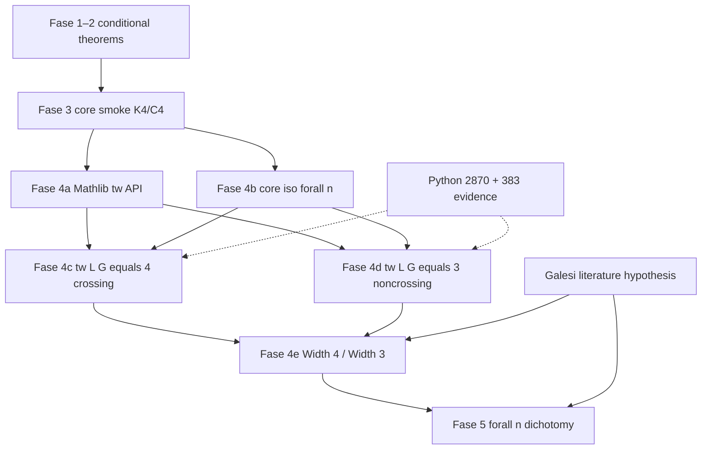

# Fase 4–5 roadmap — universal crossing law (∀n)

**Project:** PNPLab ChordWidth  
**Updated:** 2026-08-03  
**Target theorem (Fase 5):**

\[
\forall n \ge 5,\ \forall\ \text{valid two-chord } G \text{ on } C_n,\ \forall\ \text{odd marking } \varphi:\quad
\mathrm{Width}(T(G,\varphi)) = 3 \leftrightarrow \text{noncrossing}.
\]

**Paper:** [CHORD_DIAGRAM_TSEITIN_WIDTH.md](../papers/CHORD_DIAGRAM_TSEITIN_WIDTH.md)  
**Lean status:** [CHORD_WIDTH_LEAN_STATUS.md](CHORD_WIDTH_LEAN_STATUS.md)

---

## What is proven today

### Conditional (Fase 1–2) — Lean, green

| Item | Status |
|------|--------|
| `TseitinWidthTreewidthCharacterization` as literature hypothesis field | Structure only |
| `width_from_treewidth_of_characterization` | **Proved** — if Galesi holds and tw(L(G)) = k, then Width = max(3, k) |
| `two_chord_width_from_characterization` | **Proved** — same for `CycleTwoChordGraph` |
| `noncrossing_width_eq_three_when_tw_le_two` | **Proved** — conditional noncrossing ⇒ width 3 |

These are **not** the universal crossing law — they assume the literature width identity and a tw(L(G)) bound as input.

### Structural core (Fase 3) — Lean smoke, green

| Item | Status |
|------|--------|
| Degree-2 suppression (`DegreeTwoSuppression.lean`) | Definitions + transport lemmas |
| `SuppressedCore.isK4` / `isFourCycle` | Structural predicates |
| `c5Ofold_crossing_core_k4` | **Proved** on crossing C₅ smoke + instance transport |
| `c8Nested_noncrossing_core` | **Proved** on nested C₈ smoke + instance transport |
| `EliminationOrder` scaffolding for K₄ / C₄ | Smoke witnesses only — not tw(L(G)) |

**Gap:** no `SimpleGraph.Iso` to standard K₄ or C₄; no ∀n classification theorem.

### Computational evidence (Python) — not Lean proofs

| Sweep | Range | Result | Method |
|-------|-------|--------|--------|
| Exact | n = 5..14 | **2870/2870**, 0 counterexamples | Exact tw search ([CHORD_TREewidth_EXACT_N5_N14.md](CHORD_TREewidth_EXACT_N5_N14.md)) |
| Representative | n = 5..100 | **383/383**, 0 counterexamples | Witness + heuristic upper bound for large n ([CHORD_TREewidth_VERIFICATION.md](CHORD_TREewidth_VERIFICATION.md)) |

---

## What is needed (Fase 4 → Fase 5)

### Fase 4 — Real tw(L(G)) bounds + width laws

| Block | Deliverable | Blocker |
|-------|-------------|---------|
| **4a. Mathlib treewidth API** | `SimpleGraph.treeWidth` or pathwidth + basic lemmas | PR [#38334](https://github.com/leanprover-community/mathlib4/pull/38334) not merged in v4.32 pin |
| **4b. Core isomorphism** | Prove suppressed core ≅ K₄ (crossing) or ≅ C₄ + bundles (noncrossing) for all valid instances | Needs graph iso infrastructure + ∀n combinatorics |
| **4c. tw(L(G)) crossing** | Prove tw(L(G)) = 4 when chords cross | Elimination order / separator on L(G), or reduction from K₄ core |
| **4d. tw(L(G)) noncrossing** | Prove tw(L(G)) = 3 when noncrossing | Outerplanar / ear arguments; may need `IsOuterplanar` |
| **4e. Width = 4 / Width = 3** | `CrossingWidth4.lean`, `NoncrossingWidth3.lean` via Galesi + 4c/4d | Depends on literature hypothesis + tw bounds |
| **4f. Odd marking φ** | Full Tseitin axioms beyond `oddCharge p0 = 1` | Parametric instance wiring |

**Fase 4 exit criterion:** For all valid two-chord G on C_n (n ≥ 5), proved tw(L(G)) ∈ {3, 4} with correct crossing bit, and conditional Width = max(3, tw(L(G))) instantiated to 3 or 4.

### Fase 5 — Universal dichotomy

| Block | Deliverable |
|-------|-------------|
| **5a. ∀n core classification** | Single theorem: crossing ↔ K₄-type core, noncrossing ↔ C₄-type |
| **5b. ∀n tw dichotomy** | tw(L(G)) = 3 ↔ noncrossing, tw(L(G)) = 4 ↔ crossing |
| **5c. ∀n odd φ** | Quantify over all odd markings, not a fixed charge pattern |
| **5d. Main theorem** | `cycle_two_chords_resolution_width` — Width = 3 ↔ noncrossing |
| **5e. No lookup / no mass tables** | Replace legacy 461-instance / native_decide catalogs entirely |

**Fase 5 exit criterion:** One unconditional (modulo explicitly labeled literature imports) Lean theorem matching the PNPLab crossing law for all n.

---

## Estimated timeline

Assumes part-time effort (~10–15 h/week) and Mathlib treewidth landing within 6 months.

| Phase | Scope | Optimistic | Realistic | Pessimistic |
|-------|-------|------------|-----------|-------------|
| **Fase 4a** | Mathlib tw API available / pinned | 1–2 mo | 3–6 mo | 12+ mo (if #38334 stalls) |
| **Fase 4b–d** | Core iso + tw(L(G)) bounds | 2–3 mo | 4–8 mo | 12+ mo |
| **Fase 4e–f** | Width laws + odd φ | 1 mo | 2–4 mo | 6 mo |
| **Fase 5** | ∀n dichotomy + main theorem | 1–2 mo | 3–6 mo | 12 mo |

**End-to-end (Fase 4 + 5):** ~6–12 months realistic; **18–24 months** if Mathlib treewidth delays or core iso proves harder than expected.

---

## Risk factors

| Risk | Impact | Mitigation |
|------|--------|------------|
| **Mathlib #38334 delayed or API changes** | Blocks real tw proofs; stuck on stubs | Local `EliminationOrder` witnesses; engage Zulip early ([COMMUNITY_QUESTION_DRAFT.md](COMMUNITY_QUESTION_DRAFT.md)) |
| **tw(L(G)) ≠ core tw** | K₄ core tw = 3 but need tw(L(G)) = 4 — different graphs | Focus proofs on **L(G)** directly; Harvey–Wood bounds as scaffold only |
| **No `IsOuterplanar` in Mathlib** | Noncrossing branch harder to formalize | Primal outerplanarity lemmas by hand; or separator-based tw bounds on L(G) |
| **Core iso ∀n combinatorics** | Smoke proofs don't generalize | Pen-and-paper lemma first; MathOverflow query for graph-theory shortcut |
| **Galesi width not in Mathlib / not trusted** | Main theorem stays conditional | Keep explicit `TseitinWidthTreewidthCharacterization` hypothesis; literature audit already done |
| **Python heuristic for n > 14** | 383/383 uses upper bounds — could hide counterexample | Exact sweep already to n = 14; extend exact range as compute allows |
| **Odd marking corner cases** | Width may depend on φ beyond parity | Audit Tseitin unsat for connected G; follow Galesi corollary hypotheses |
| **Scope creep** | Re-proving Galesi or full cop–robber game | Stay scoped to tw(L(G)) dichotomy for Δ = 3 two-chord family only |

---

## Dependency graph

---

## Honest bottom line

- **Strongest asset:** exact Python validation (2870/2870 for n ≤ 14) + green Lean scaffold with structural core smoke.
- **Weakest link:** no real treewidth in Mathlib v4.32 and no ∀n graph-theoretic proof — Fase 4 is gated on community infra + proof strategy.
- **Universal theorem is achievable** as a conditional result (Galesi + tw dichotomy) once Fase 4 closes; making Galesi unconditional is **out of scope** for this pivot unless we expand to reprove the cop–robber characterization.

Community outreach: [ZULIP_POSTING_GUIDE.md](ZULIP_POSTING_GUIDE.md) · Draft posts: [COMMUNITY_QUESTION_DRAFT.md](COMMUNITY_QUESTION_DRAFT.md)
